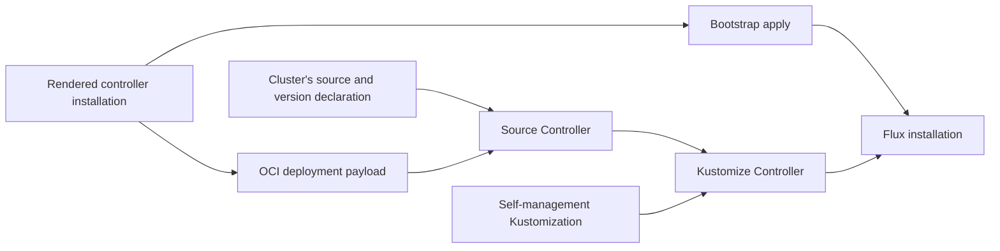

# Architecture overview

> [!NOTE]
> Read this document to understand the boundary between the reusable Flux package, a consuming
> cluster definition, and the controllers that reconcile the installation.

The [product documents](../product/README.md) explain the package's purpose and operating model.
This overview describes how the current implementation supports them and identifies the intended
self-management boundary where implementation still needs to change.

## One reusable installation

This repository produces one release unit: the Cur8s Flux installation. Its upstream inputs and
authored configuration determine the controller installation before it reaches a cluster. The
rendered installation is committed as a reviewable deployment payload, then distributed through
an OCI registry.

The package installs the source, kustomize, and notification controllers. Their selected roles and
the broader APIs they install are defined in [the package's opinion](../product/02-the-opinion.md).

| Responsibility | Current owner | Implementation |
| --- | --- | --- |
| Upstream and package identity | Package repository | Version and identity declarations in [`mise.toml`](../../mise.toml). |
| Controller installation | Package repository | Captured upstream manifests composed with [`source configuration`](../../src/config/overlays/deploy/kustomization.yaml). |
| Rendered deployment payload | Package repository | The committed [`artifacts/rendered/`](../../artifacts/rendered/) tree. |
| Artifact location, version selection, and credentials | Consuming cluster definition | The `OCIRepository` used by that cluster. |
| Self-management Kustomization | Package repository, applied by the consumer | [`sync.yaml`](../../src/config/sync.yaml), which references the consumer's source. |
| Integration with other components | Consuming cluster definition | Its composition, ordering, and integration verification. |

Cluster-specific source selection stays outside the reusable installation. The same package can
therefore be reconciled from a local development registry or a production registry without
rebuilding its controller resources for that endpoint.

## Bootstrap and reconciliation share installation content

Flux must be installed before it can reconcile its own resources. Bootstrap applies the static
controller installation directly to the Kubernetes API. After the required controllers and CRDs
are available, a separate apply establishes the source and self-management Kustomization.

The distribution contract uses the same rendered controller installation for both bootstrap YAML
and the OCI payload. Bootstrap establishes the machinery; subsequent reconciliation maintains
that installation from the declared artifact. Version changes flow through the cluster definition's
source selection. Reapplying matching bootstrap content is also the recovery path when Flux itself
is unavailable.

The current artifact includes `deploy/flux.yaml`, the controller installation; `sync.yaml`, the
self-management Kustomization; and `cur8s.yaml`, an inert release descriptor. The Kustomization
selects the artifact's `deploy/` directory, so the descriptor and self-management file are not
applied as controller installation content.

The repository's OCI publication script does not automate attaching
the matching installation YAML to a GitHub release. That publication requirement must remain
distinct from what the script currently performs.

## Intended self-management boundary

The intended boundary places both the `OCIRepository` and self-management `Kustomization` in the
consuming repository. Each consumer then declares its source, version, reconciliation path, and
other self-management settings together, while this package provides the reusable installation.

The current implementation still ships `sync.yaml` inside the package. Moving self-management
configuration to consumers remains implementation work; the ownership table above describes the
current artifact, rather than claiming that transition has happened.

## Verification responsibilities

The package must reproduce its committed deployment payload from the pinned inputs and authored
configuration. Its end-to-end verification must establish that a fresh installation starts and
then converges under Flux self-management from the OCI artifact. A green end-to-end run is a release
acceptance requirement.

Consuming repositories own verification of their source configuration and interactions with other
components. Package verification establishes the Flux installation and handoff; it does not prove
every consumer composition or Kubernetes runtime compatible.

The [user guide](../user-guide.md) contains the current installation and operation procedures.
Continue with [From source to artifact](01-source-to-artifact.md) for the rendering pipeline.
The [metadata explanation](02-artifact-contents-and-metadata.md) identifies the artifact content.
[Publication and self-management](03-publication-and-self-management.md) describes runtime
verification and publication mechanics.
