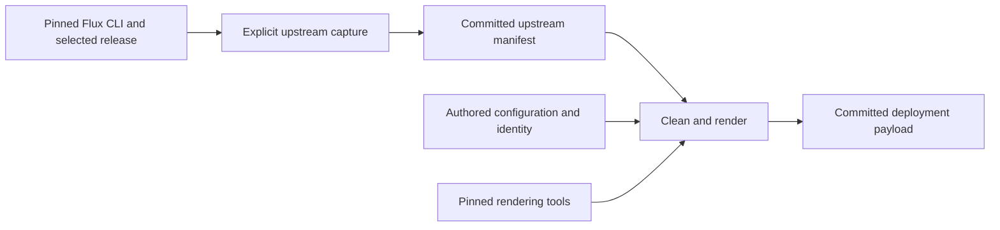

# From source to artifact

> [!NOTE]
> Read this document to understand how pinned upstream input and authored configuration become
> the committed deployment payload, and what the rendering and verification steps establish.

The [architecture overview](00-overview.md) defines the package boundary. Within that boundary,
the pipeline separates upstream capture, authored transformations, and generated output. Capture
changes the recorded upstream input; rendering regenerates the payload from that input without
implicitly capturing it again.

## Inputs and ownership

| Input | Role | How it changes |
| --- | --- | --- |
| [`mise.toml`](../../mise.toml) | Authored versions, pinned tools, and component identity. | Deliberate changes to the upstream selection, package revision, toolchain, or identity. |
| [`mise.lock`](../../mise.lock) | Tool download locations and checksums for the locked platforms. | Refreshed when the selected versions or tool pins change. |
| [`upstream/flux.yaml`](../../upstream/flux.yaml) | Captured Flux controller installation generated by the pinned Flux CLI. | Replaced by explicit upstream capture. |
| [`src/config/overlays/deploy/kustomization.yaml`](../../src/config/overlays/deploy/kustomization.yaml) | Authored composition of the captured installation. | Reviewed changes to the package's installation configuration. |
| [`src/config/sync.yaml`](../../src/config/sync.yaml) | Current package-owned self-management Kustomization. | Reviewed changes to the shipped reconciliation configuration. |

`FLUX_VERSION` selects the upstream release and the Flux CLI pin. `CUR8S_FLUX_REVISION` identifies
configuration changes against that release. The derived package version and component identity
feed the rendered descriptor. The current version derivation is expressed in the configuration;
it is separate from how manifests are captured and transformed.

The captured manifest is committed upstream input. It is generated rather than hand-authored,
but retaining it allows rendering to consume a reviewed snapshot without reaching for upstream
again. The overlays and self-management configuration are authored inputs. The generated
[`artifacts/rendered/`](../../artifacts/rendered/) tree is also committed, so reviewers can inspect
the payload those inputs produce.

## Disposable generated output

This repository produces one package, so local paths do not repeat the component name. Captured
inputs belong in [`upstream/`](../../upstream/README.md) and authored configuration in
[`src/`](../../src/README.md). All generated output belongs under `artifacts/`:

| Directory | Role | Git treatment |
| --- | --- | --- |
| `artifacts/rendered/` | Complete regenerated deployment payload, including the descriptor and current sync file. | Committed for review with its producing input or configuration change. |
| `artifacts/oci/` | Reserved for a future locally packaged OCI artifact. | Ignored; no local packaging step is implemented yet. |

The entire `artifacts/` tree is disposable. Keep all authored content, including orientation
README files, outside it. Deleting it and running `build:render` restores the rendered files
solely from captured inputs, authored configuration, and pinned configuration/tools. Capture
is an explicit input update, not part of ordinary regeneration. No local packaged OCI output is
needed by the current render or publisher.

Flattening these local paths does not change the registry identity `flux`, the artifact's internal
`deploy/` directory, or the self-management path `./deploy`.

## Explicit capture and rendering

The [mise configuration](../../mise.toml) defines the task grammar; the scripts implement each
operation. Their pipeline responsibilities are:

| Task | Reads | Writes or removes |
| --- | --- | --- |
| [`upstream:fetch`](../../.mise/tasks/upstream/fetch) | The pinned Flux CLI and selected release. | Replaces only `upstream/flux.yaml` with the captured installation manifest. |
| [`build:clean`](../../.mise/tasks/build/clean) | No inputs. | Removes the whole generated `artifacts/` tree, preserving captured and authored inputs. |
| [`build:render`](../../.mise/tasks/build/render) | Captured manifest, authored configuration, pinned Kustomize, and component identity. | Runs clean, then writes the controller installation, copied sync file, and release descriptor under `artifacts/rendered/`. |

For Flux, capture runs `flux install --export` with the source, kustomize, and notification
controllers in `flux-system`. It replaces the previous captured manifest, preserving the upstream
orientation file. This is generation through the pinned upstream CLI, rather than a download of a
separately published YAML asset.

Rendering requires the captured manifest to exist. Its clean dependency runs before the render
script checks that prerequisite, so a missing input fails visibly after generated output has been
removed. Rendering does not invoke capture; the captured input remains available after cleaning.

Kustomize composes the captured installation with the authored deploy overlay. The overlay adds
the Cur8s component label and preserves resource ordering with FIFO sorting. The render script
then copies the current self-management Kustomization and generates the inert release descriptor.
It does not query a cluster to choose installation resources.

## The committed review surface

The rendered tree is the payload that publication consumes. Change captured inputs or authored
configuration, then regenerate that tree; do not hand-edit the generated output. Review the
resulting source and rendered changes together.

Rendering from the same captured inputs, authored configuration, component identity, and pinned
toolchain must reproduce the same file content. The descriptor excludes a render timestamp and
Git revision, which would otherwise make output change independently of those inputs. Registry
annotations and the distinction between file content and OCI packaging are described in the
[artifact metadata explanation](02-artifact-contents-and-metadata.md).

This reproducibility requirement concerns the rendered files. It does not, by itself, prove that
separate OCI pushes have identical manifest digests or that every target Kubernetes runtime accepts
the installation.

## What verification establishes

[`test:run`](../../.mise/tasks/test/run) begins by explicitly capturing upstream, then rendering,
in that order. It checks both the captured upstream area and the generated artifact tree for Git changes.
A clean result establishes that fresh capture and rendering agree with the committed review
surface. The current check includes staged changes, so a correct regeneration still fails while
its updated output is uncommitted.

After that check, the test creates a disposable environment through
[`.mise/env.sh`](../../.mise/env.sh), which boots Flux, publishes the payload to its local
registry, and verifies self-management. Drift checking evaluates agreement with the recorded files;
the cluster test evaluates installation and reconciliation on its selected runtime. The test task
combines both checks. [`dev:create`](../../.mise/tasks/dev/create) and
[`dev:update`](../../.mise/tasks/dev/update) run `build:render` automatically without fetching upstream.

[`oci:publish`](../../.mise/tasks/oci/publish) publishes the existing rendered payload without
fetching or rendering. Publication behavior and release acceptance requirements are separate from
rendering; the [publication explanation](03-publication-and-self-management.md)
describes that boundary.
